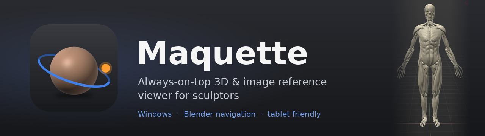
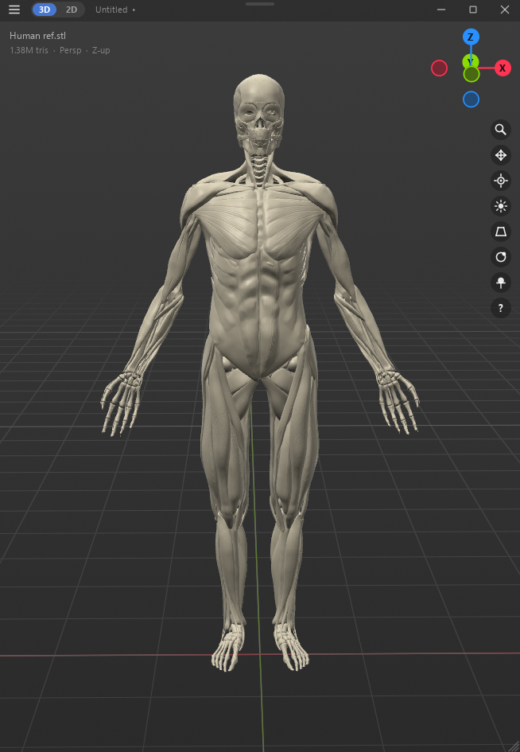
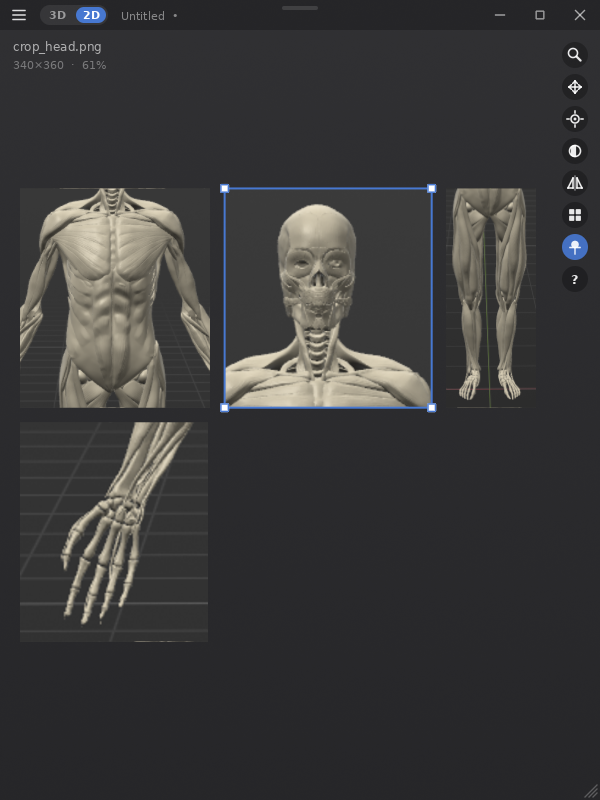
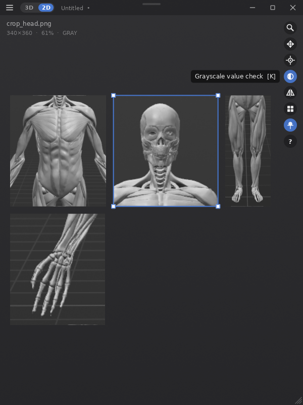
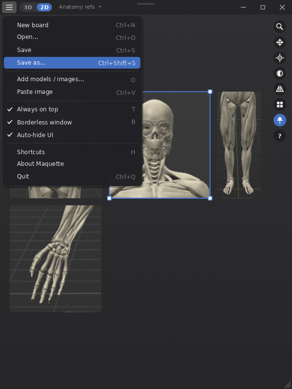
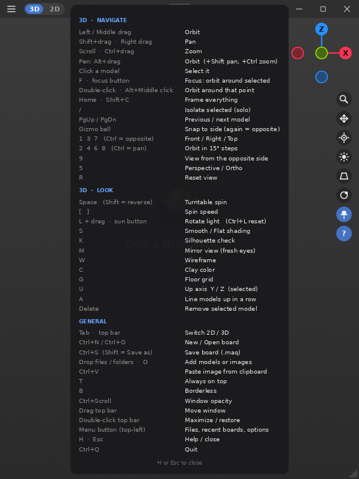
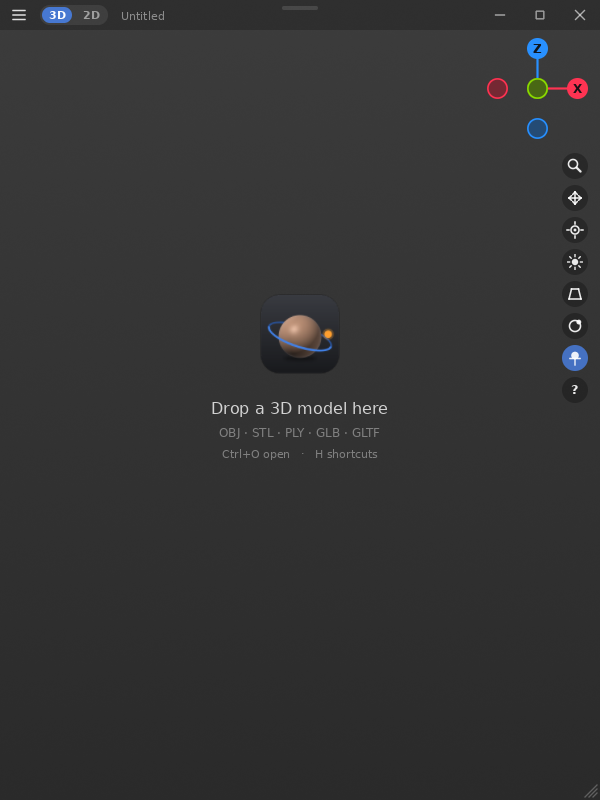

  

  
  
  

**Maquette** is a small floating window that keeps your anatomy reference right next to your sculpt. You can load professional 3D reference models and images, orbit around them with Blender controls, and get back to sculpting.

> A *maquette* is the small study model a sculptor keeps beside the main piece.

  

---

## ⬇️ Quick installation

1. **[Download `Maquette-Setup-1.0.0.exe`](../../releases/latest/download/Maquette-Setup-1.0.0.exe)** from the [latest release](../../releases/latest).
2. Run it.
   - Windows may show *"Windows protected your PC"* because the app isn't code-signed. Click **More info → Run anyway**.
3. Open **Maquette** from the Start menu and drag a 3D model (OBJ, STL, GLB, PLY) or an image onto the window.

The installer needs no admin rights and adds:
- a Start-menu entry and an optional desktop icon
- double-click-to-open for `.maq` boards
- an *Open with* entry for 3D models
- a normal uninstaller

**Want all the files?** Download **`Maquette-1.0.0-full.zip`** from the [release page](../../releases/latest) to get the complete project, including source, build scripts and assets.

---

## ✨ Features

| | |
|---|---|
| 📌 **Always on top** | A clean, borderless, PureRef-style window that floats over ZBrush, Blender or anything else |
| 🧭 **Blender navigation** | Same mouse and numpad keys, plus a clickable axis gizmo |
| ✏️ **Drawing-tablet friendly** | Alt-drag to orbit, pan and zoom, the same as Blender's *Emulate 3 Button Mouse* |
| 🎯 **Focus mode** | Click a model and press **F**: the camera orbits around it. Double-tap any surface to orbit around that point |
| 🖼️ **2D image board** | Drop or paste (Ctrl+V) images, then move, scale, flip, use grayscale value checks and auto-arrange |
| 🔦 **Sculpting checks** | Rotatable studio light, silhouette mode, mirror view, flat shading, turntable spin |
| 💾 **Boards** | Save and open everything as a `.maq` file, with recent boards in the menu |
| 🫥 **Auto-hiding UI** | The UI fades away when your cursor leaves, so only the model remains, and pops back when you return |
| 🪶 **Lightweight** | Uses 0% CPU/GPU when idle. Multi-million-triangle meshes are cached and reopen in under a second |

## 📸 Screenshots

<table>
  <tr>
    <td align="center"> 2D image board</td>
    <td align="center"> Grayscale value check + flip</td>
    <td align="center"> Menu: boards, recent files, options</td>
  </tr>
  <tr>
    <td align="center"> Built-in shortcut sheet (H)</td>
    <td align="center"> Start screen</td>
    <td align="center"> 3D anatomy reference</td>
  </tr>
</table>

---

## 🎮 Controls

### Mouse, the Blender way
| Input | Action |
|---|---|
| Left drag / Middle drag | Orbit |
| Shift + drag / Right drag | Pan |
| Scroll / Ctrl + drag | Zoom |
| Click a model, then **F** | Focus on it |
| Double-click a surface / Alt + Middle click | Orbit around that point |
| Click a gizmo ball | Snap to that side (click again for the opposite side) |

### Drawing tablet
| Pen | Action |
|---|---|
| **Alt + drag** | Orbit |
| **Alt + Shift + drag** | Pan |
| **Alt + Ctrl + drag** | Zoom |

### Keys
| Key | Action |
|---|---|
| `1` `3` `7` (Ctrl = opposite) | Front / Right / Top |
| `9` | Opposite side |
| `2` `4` `6` `8` | Orbit in 15° steps |
| Ctrl + `2` `4` `6` `8` | Pan |
| `5` | Persp / Ortho |
| `Home` / `Shift+C` | Frame all |
| Numpad `.` / `F` | Focus selected |
| `/` | Isolate |
| `Space` | Turntable spin |
| `L` + drag | Rotate light |
| `K` | Silhouette (3D) / Grayscale (2D) |
| `M` | Mirror view (3D) / Flip (2D) |
| `S` | Flat shading |
| `W` | Wireframe |
| `C` | Clay color |
| `G` | Grid |
| `U` | Fix up axis |
| `Tab` | Switch 2D / 3D |
| `Ctrl+N` / `Ctrl+O` / `Ctrl+S` | New / Open / Save board |
| `Ctrl+V` | Paste image |
| `T` | Always on top |
| `Ctrl+Scroll` | Window opacity |
| `H` | All shortcuts |

### Formats
- **3D:** OBJ · STL · PLY · GLB · GLTF · OFF
- **Images:** PNG · JPG · WEBP · BMP · GIF · TIFF

FBX and ZTL aren't supported. Export them as OBJ or GLB from Blender or ZBrush.

---

## 🛠️ Build from source

You need Windows and Python 3.10–3.13. The scripts install anything missing.

| Script | What it does |
|---|---|
| `setup.bat` | Creates a virtual environment and installs dependencies |
| `run.bat` | Runs Maquette from source |
| `build_exe.bat` | Builds a standalone `dist\Maquette\Maquette.exe` with PyInstaller |
| `build_installer.bat` | Builds the exe and then `installer_output\Maquette-Setup-1.0.0.exe` with Inno Setup |

Built with Python, [GLFW](https://www.glfw.org/), [ModernGL](https://github.com/moderngl/moderngl), [trimesh](https://trimesh.org/), [NumPy](https://numpy.org/) and [Pillow](https://python-pillow.org/).

Settings, the mesh cache and pasted images are stored in `%APPDATA%\Maquette` for the installed app, or next to `maquette.py` when you run from source.

---

## 🤖 Vibe coded: generated by Claude

This project was **vibe coded**. All of the code, scripts, installer setup, logo and documentation were generated by **[Claude](https://claude.ai)** (Anthropic) through a conversation. The idea, direction, testing and the anatomy screenshot came from me, a sculptor who wanted PureRef with 3D models in it.

Issues and pull requests are welcome.

## 📄 License

[MIT](LICENSE). Free to use, modify and share.

The anatomy model in the screenshots belongs to its original author and isn't included in this repository.
